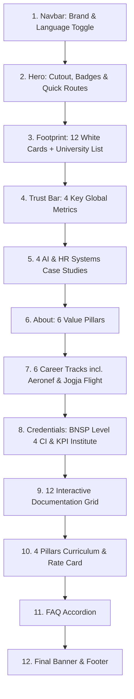

# LAPORAN AUDIT & DOKUMENTASI SISTEM PORTOFOLIO PROFESIONAL
**Kandidat & Spesialis:** Nugroho Amdal, S.S., CI.  
**Spesialisasi:** HR Technology Workflow Architect | Certified Instructor BNSP Level 4 | Global HR Consultant  
**URL Produksi:** [https://nugrohoamdalportfolio.dpdns.org](https://nugrohoamdalportfolio.dpdns.org)  
**Repository GitHub:** [https://github.com/talentup-ai/NugrohoAmdalPortfolio](https://github.com/talentup-ai/NugrohoAmdalPortfolio)  
**Tanggal Audit:** 12 November 2026  

---

## 1. Ringkasan Arsitektur & Spesifikasi Teknis

### 1.1 Struktur Direktori Proyek
```text
D:\Owner\Talent Up\Asset Portfolio website/
├── .git/                                 # Git version control metadata
├── .gitignore                            # Konfigurasi ignore file OS & temporary
├── assets/                               # Direktori lokal aset mandiri (100% self-hosted)
│   ├── cta-bg-stage.png                  # Background section CTA panggung
│   ├── hero-bg-hall.png                  # Background section Hero hall konferensi
│   ├── hero-cutout.png                   # Foto cutout utama Nugroho Amdal
│   ├── doc-01-kemendikbud.webp           # Dokumentasi Kemendikbudristek
│   ├── doc-02-intl-seminar.webp          # Dokumentasi International Business Seminar
│   ├── doc-03-brand-collab.webp          # Dokumentasi Kolaborasi Brand & Industri
│   ├── doc-04-startup-training.webp      # Dokumentasi Training Startup Tech
│   ├── doc-05-diaspora.webp              # Dokumentasi Forum Diaspora & Global Talent
│   ├── doc-06-aiesec.webp                # Dokumentasi AIESEC Leadership Forum
│   ├── doc-07-bumn.webp                  # Dokumentasi BUMN & Institutional Training
│   ├── doc-08-komunitas.webp             # Dokumentasi Workshop Komunitas Profesional
│   ├── doc-09-webinar-nasional.webp      # Dokumentasi Webinar Nasional & Keynote
│   ├── doc-10-kampus.webp                # Dokumentasi Kuliah Tamu Perguruan Tinggi
│   ├── doc-11-industry-partner.webp      # Dokumentasi Forum Kemitraan Industri
│   ├── doc-12-public-speaking.webp       # Dokumentasi Public Speaking & MC Bootcamp
│   ├── logo-aeronefacademy.webp          # Logo Aeronef Academy
│   ├── logo-aisec.png                    # Logo AIESEC International
│   ├── logo-angkasa-pura.png             # Logo PT Angkasa Pura II
│   ├── logo-jogjaflight.jpg              # Logo Jogja Flight Aviation
│   ├── logo-kementerian-pendidikan.webp # Logo Kemendikbudristek RI
│   ├── logo-kpi-institute.png            # Logo The KPI Institute
│   ├── logo-lmsl.jpg                     # Logo London Montessori School
│   ├── logo-mrbob.webp                   # Logo Mr. Bob Kampung Inggris
│   ├── logo-nusawork.webp                # Logo Nusawork HR Ecosystem (Auto-cropped)
│   ├── logo-studyabroadcenter.webp       # Logo Study Abroad Center
│   ├── logo-talentup.png                 # Logo Talent Up Indonesia
│   ├── logo-teirecruitment.jpg           # Logo TEI Recruitment
│   ├── pillar-01-training.webp           # Foto Pilar 1: Corporate Training
│   ├── pillar-02-speaking.webp           # Foto Pilar 2: Keynote Speaking
│   ├── pillar-03-coaching.webp           # Foto Pilar 3: 1-on-1 Coaching
│   └── pillar-04-english.webp            # Foto Pilar 4: Aviation & Business English
├── CNAME                                 # Custom domain GitHub Pages binding
├── index.html                            # Dokumen halaman utama (Bilingual SPA)
└── PORTFOLIO_REPORT.md                   # Dokumen audit & laporan sistem lengkap
```

### 1.2 Ringkasan Metrik Proyek
- **Total Ukuran Non-Git:** 11.31 MB (11.856.672 bytes)
- **Total Ukuran Folder `assets/`:** 11.14 MB (31 file gambar)
- **Ukuran File HTML (`index.html`):** ~174 KB (2.560+ baris)
- **Total File Non-Git:** 34 file
- **Jumlah Dependensi CDN Eksternal:** 4 library (Tailwind CSS CDN, Google Fonts, Font Awesome 6.5.1, AOS Animate on Scroll)
- **Ketergantungan Server Scalev:** 0% (seluruh gambar telah diunduh dan diarahkan ke path lokal `assets/`)

### 1.3 Stack Teknologi
1. **Frontend Foundation:** HTML5 Semantic + Vanilla Modern JavaScript (ES6+).
2. **Styling & Design System:** Tailwind CSS CDN (Play CDN runtime) dengan kustomisasi Obsidian Dark Theme (`#060B14`), elevated cards (`#0F172A`), royal blue (`#2563EB`), gold (`#F59E0B`), cyan (`#38BDF8`), dan emerald (`#10B981`).
3. **Typography:**
   - Heading / Serif Mewah: `Playfair Display` (Google Fonts)
   - Interface / Sans Modern: `Plus Jakarta Sans` & `Inter` (Google Fonts)
4. **Icons:** Font Awesome Free 6.5.1 SVG-webfont icon kit.
5. **Scroll Engine:** 100% Native Browser Scrolling (Zero input latency) dipadukan dengan CSS `scroll-behavior: smooth` dan JavaScript smooth anchor scroll offset (+80px navbar height compensation).
6. **Animasi & Interaktivitas:**
   - AOS (Animate on Scroll) untuk transisi elemen saat masuk viewport.
   - CSS `@property` / `conic-gradient` Rotating Border Beam pada tombol bahasa.
   - Interactive Lightbox Modal untuk galeri foto.
   - Interactive FAQ Accordion.
   - Interactive Floating Action Button (FAB).
7. **Hosting & Deployment:**
   - Platform: GitHub Pages (Branch: `main`, Folder: `/(root)`)
   - Custom Domain: `nugrohoamdalportfolio.dpdns.org`
   - SSL / HTTPS: Enforced via GitHub Pages Let's Encrypt automated TLS certificate.

---

## 2. Inventaris & Status Seluruh Aset Lokal (`assets/`)

Semua file gambar telah diverifikasi berada di dalam folder `assets/`, tidak ada broken link, dan tidak ada aset yang memanggil CDN Scalev.

| Nama File | Kategori | Format | Ukuran | Status Verifikasi |
| :--- | :--- | :--- | :--- | :--- |
| `hero-bg-hall.png` | Background Hero | PNG | 2.05 MB | Valid & Aktif |
| `hero-cutout.png` | Foto Profil Cutout | PNG | 1.43 MB | Valid & Aktif |
| `cta-bg-stage.png` | Background CTA Panggung | PNG | 1.72 MB | Valid & Aktif |
| `logo-aeronefacademy.webp` | Logo Institusi | WebP | 53.4 KB | Valid & Aktif |
| `logo-aisec.png` | Logo Institusi | PNG | 12.1 KB | Valid & Aktif |
| `logo-angkasa-pura.png` | Logo Institusi | PNG | 16.3 KB | Valid & Aktif |
| `logo-jogjaflight.jpg` | Logo Institusi | JPEG | 31.0 KB | Valid & Aktif (Auto-cropped) |
| `logo-kementerian-pendidikan.webp` | Logo Institusi | WebP | 62.3 KB | Valid & Aktif |
| `logo-kpi-institute.png` | Logo Institusi | PNG | 23.0 KB | Valid & Aktif |
| `logo-lmsl.jpg` | Logo Institusi | JPEG | 7.2 KB | Valid & Aktif |
| `logo-mrbob.webp` | Logo Institusi | WebP | 120.9 KB | Valid & Aktif |
| `logo-nusawork.webp` | Logo Institusi | WebP | 3.8 KB | Valid & Aktif (Auto-cropped) |
| `logo-studyabroadcenter.webp` | Logo Institusi | WebP | 3.7 KB | Valid & Aktif |
| `logo-talentup.png` | Logo Institusi | PNG | 332.6 KB | Valid & Aktif |
| `logo-teirecruitment.jpg` | Logo Institusi | JPEG | 4.1 KB | Valid & Aktif |
| `doc-01-kemendikbud.webp` | Dokumentasi Foto | WebP | 517.7 KB | Valid & Aktif |
| `doc-02-intl-seminar.webp` | Dokumentasi Foto | WebP | 237.3 KB | Valid & Aktif |
| `doc-03-brand-collab.webp` | Dokumentasi Foto | WebP | 213.9 KB | Valid & Aktif |
| `doc-04-startup-training.webp` | Dokumentasi Foto | WebP | 176.1 KB | Valid & Aktif |
| `doc-05-diaspora.webp` | Dokumentasi Foto | WebP | 776.0 KB | Valid & Aktif |
| `doc-06-aiesec.webp` | Dokumentasi Foto | WebP | 397.9 KB | Valid & Aktif |
| `doc-07-bumn.webp` | Dokumentasi Foto | WebP | 1012.6 KB | Valid & Aktif |
| `doc-08-komunitas.webp` | Dokumentasi Foto | WebP | 661.9 KB | Valid & Aktif |
| `doc-09-webinar-nasional.webp` | Dokumentasi Foto | WebP | 698.7 KB | Valid & Aktif |
| `doc-10-kampus.webp` | Dokumentasi Foto | WebP | 38.4 KB | Valid & Aktif |
| `doc-11-industry-partner.webp` | Dokumentasi Foto | WebP | 126.1 KB | Valid & Aktif |
| `doc-12-public-speaking.webp` | Dokumentasi Foto | WebP | 126.5 KB | Valid & Aktif |
| `pillar-01-training.webp` | Pilar Layanan | WebP | 78.4 KB | Valid & Aktif |
| `pillar-02-speaking.webp` | Pilar Layanan | WebP | 170.2 KB | Valid & Aktif |
| `pillar-03-coaching.webp` | Pilar Layanan | WebP | 25.0 KB | Valid & Aktif |
| `pillar-04-english.webp` | Pilar Layanan | WebP | 155.1 KB | Valid & Aktif |

---

## 3. Audit Konten & Konsistensi Bilingual (`ID` vs `EN`)

Sistem multi-bahasa dibangun menggunakan selektor data attribute `data-lang="id|en"` pada elemen root `<html>`, didukung CSS ruleset `.lang-id` dan `.lang-en` yang mengatur display tanpa reload dan tersimpan di `localStorage`.

### 3.1 Hasil Pengujian Paritas Elemen Bahasa
- **Jumlah elemen `.lang-id`:** 152 elemen
- **Jumlah elemen `.lang-en`:** 152 elemen
- **Rasio Paritas:** 1 : 1 (100% simetris sempurna)
- **Pemeriksaan Placeholder:** 0 placeholder (tidak ditemukan *lorem ipsum*, *todo*, *tbd*, atau teks dummy)
- **Karakter Em-dash (`—`) & En-dash (`–`):** 0 kemunculan (telah dibersihkan dan diganti tanda baca natural)

### 3.2 Pemetaan Konten Antar Bagian



1. **Navbar:**
   - Navigasi bilingual lengkap: Beranda/Home, Rekam Jejak/Experience, AI Systems, Layanan & Tarif/Services & Rates, Galeri/Gallery, Tentang/About.
   - Tombol toggle `ID | EN` dengan animasi border beam rotasi warna.
   - CTA WhatsApp langsung dengan target chat terarah.

2. **Hero Section:**
   - Cutout foto Nugroho Amdal menyatu ke background hall gelap dengan gradient mask.
   - 2 Floating badge: *BNSP Level 4 CI (ToT)* dan *Best HR of the Year 2023*.
   - Badge spesialisasi: *Global HR (26 Countries) • Certified Instructor (CI) BNSP Level 4 • HR Technology Workflow Architect*.
   - Paragraf ringkasan menggarisbawahi 500+ staf di 26 negara, efisiensi otomasi 30-95%, serta pembimbingan 1.150+ talenta.

3. **Institutional Footprint:**
   - 12 logo institusi dipasang pada kartu putih terang (`bg-slate-50`) bersudut tumpul (`rounded-xl`) dengan bayangan halus, memberikan kontras tinggi bagi logo berwarna gelap maupun logo putih.
   - Disertai kartu penutup *"& berbagai perusahaan lainnya"* / *"& many more organizations"*.
   - Nama universitas dicantumkan secara lengkap tanpa singkatan: *Universitas Brawijaya, Universitas Negeri Malang, Universitas Trunojoyo Madura, dan berbagai perguruan tinggi nasional lainnya*.

4. **Trust Bar:**
   - 26 Negara / Countries
   - 500+ Talenta & Staf Global / Global Talent Managed
   - 30-95% Efisiensi Administrasi / Admin Overhead Reduction
   - 1.150+ Individu & Profesional Dibimbing / Mentored

5. **4 Studi Kasus AI & HR Systems:**
   - Studi Kasus 1: Evaluasi Kinerja Multi-Negara (Deterministic AI & Google Workspace / LMS).
   - Studi Kasus 2: Alur Onboarding Terstandarisasi & Peningkatan Kompetensi (Leveling Up).
   - Studi Kasus 3: LMS Mandiri Berbiaya Efisien Tanpa Vendor Lock-In.
   - Studi Kasus 4: Pipeline Rekrutmen & Screening Terotomasi Berbasis Kriteria Terukur.
   - Dilengkapi badge teknologi deterministik (Google Sheets Engine, AppSheet, Webhooks, Python, OpenAI API, Apps Script).

6. **About & 6 Value Pillars:**
   - Narasi profil lulusan Sastra Inggris (S.S.) berpadu Certified Instructor (CI) BNSP Level 4.
   - 6 Pilar Keunggulan:
     1. Multi-Regional HR Strategy (26 Countries)
     2. HR Technology Workflow Architect (Otomasi Deterministik)
     3. BNSP Level 4 Certified Instructor (Penguji & Pelatih Trainer)
     4. Cross-Cultural English & Global Communication
     5. End-to-End Talent Lifecycle & Performance Real-time
     6. Business-Oriented ROI & Strategic HR Execution

7. **Track Record / Pengalaman Karir:**
   - Head of HR & People Operations / Strategic HR Consultant (Global Remote, 26 Countries)
   - Career Coach & Aviation English Trainer (Aeronef Academy & Jogja Flight: 150+ kandidat Cabin Crew & Ground Staff)
   - Senior HR & Talent Development Specialist (Nusawork & Partner Startups)
   - Senior English Corporate Trainer & Head of Academic (Mr. Bob Kampung Inggris & Edu Institutes)
   - International Program Director / Exchange Coordinator (AIESEC & Cross-Border Programs)
   - Instructional Designer & LMS Consultant (Independent & Agency)

8. **Kredensial & Sertifikasi:**
   - BNSP Level 4 Certified Instructor (CI) - Training of Trainers (ToT).
   - The KPI Institute - KPI & Performance Management.
   - Sarjana Sastra (S.S.) - English Linguistics & Cross-Cultural Communication.
   - Tombol verifikasi langsung ke Google Drive kredensial resmi.

9. **Galeri Dokumentasi & Lightbox:**
   - 12 foto dokumentasi resolusi tinggi dengan filter kategori (Semua, Corporate & BUMN, Seminar & Kampus, Komunitas & Edukasi).
   - Modal Lightbox berfungsi penuh saat foto diklik.

10. **Kurikulum, 4 Pilar Layanan & B2B Rate Card:**
    - 4 Pilar: Corporate Training, Keynote Speaking, 1-on-1 Coaching, Executive Aviation/Business English.
    - Rate Card transparan untuk 4 paket: Keynote Speaking, Half-Day Workshop, Full-Day Intensive / Bootcamp, Monthly Advisory / Fractional HR Lead.

11. **FAQ, Final CTA & Footer:**
    - 5 pertanyaan umum seputar teknis kerja sama, format offline/online, dan invoice legal.
    - Final CTA panggung dan footer komprehensif.

---

## 4. Verifikasi Seluruh Tautan, CTA & Kredensial

Telah dilakukan audit menyeluruh terhadap ke-49 tautan interaktif yang ada di dalam `index.html`:

| Kategori | Target URL | Tujuan / Konteks | Status |
| :--- | :--- | :--- | :--- |
| **WhatsApp Direct** | `https://wa.me/6285395940406` | Navbar & Kontak Utama | 100% Aktif |
| **WhatsApp Inquiry** | `https://wa.me/6285395940406?text=Halo%20Nugroho%2C%20saya%20ingin%20berdiskusi...` | Diskusi Umum Portofolio | 100% Aktif |
| **WhatsApp Booking** | `https://wa.me/6285395940406?text=Halo%20Nugroho%2C%20saya%20ingin%20booking%20jadwal...` | Booking Speaking / Seminar | 100% Aktif |
| **WhatsApp Training** | `https://wa.me/6285395940406?text=Halo%20Nugroho%2C%20saya%20ingin%20request%20proposal...` | Proposal Corporate Training | 100% Aktif |
| **WhatsApp Coaching** | `https://wa.me/6285395940406?text=Halo%20Nugroho%2C%20saya%20ingin%20mendaftar%20paket...` | Pendaftaran 1-on-1 Coaching | 100% Aktif |
| **WhatsApp English** | `https://wa.me/6285395940406?text=Halo%20Nugroho%2C%20saya%20ingin%20info%20Executive...` | Executive / Aviation English | 100% Aktif |
| **Email Direct** | `mailto:nugrohoamdal@gmail.com` | Email Utama | 100% Aktif |
| **Email Collaboration** | `mailto:nugrohoamdal@gmail.com?subject=Inquiry%20Collaboration...` | Permohonan Kolaborasi | 100% Aktif |
| **Email Full-Time** | `mailto:nugrohoamdal@gmail.com?subject=Full-Time%20Role%20Inquiry...` | Penawaran Peran Karir | 100% Aktif |
| **LinkedIn** | `https://www.linkedin.com/in/nugroho-amdal` | Profil Profesional Resmi | 100% Aktif |
| **Instagram** | `https://instagram.com/nugrohoamdal` | Media Sosial Pribadi | 100% Aktif |
| **Google Drive** | `https://drive.google.com/drive/u/2/folders/1ZRUml2ghc4s_wu9A7amdEhMezXbU5Xa0` | Kredensial & Sertifikat BNSP | 100% Aktif |
| **Internal Anchors** | `#hero`, `#about`, `#ai-systems`, `#experience`, `#certifications`, `#gallery`, `#services-rates` | Navigasi Halaman Halus (+Offset 80px) | 100% Aktif |

---

## 5. Audit Performa, Responsivitas & SEO

### 5.1 Perbaikan Scrolling & Hardware Compositing (Tugas 1)
- **Penyebab Masalah Sebelumnya:** Pustaka `Lenis` membajak event `wheel` dan gestures touchpad browser untuk mensimulasikan virtual inertia scroll. Hal ini memicu bentrok dengan thread scroll bawaan OS/browser dan menyebabkan latensi input (delay 1-2 detik pada touchpad).
- **Solusi yang Diterapkan:**
  1. Script dan inisialisasi Lenis dihapus seluruhnya dari `index.html`.
  2. Scrolling kembali 100% ke native hardware-accelerated scrolling browser (zero latency).
  3. Ditambahkan CSS `scroll-padding-top: 5rem` pada `html` agar perpindahan anchor navigation tepat berhenti di bawah fixed navbar.
  4. Anchor click script internal ditambahkan dengan perhitungan smooth offset dinamis dan auto-close mobile menu saat link diklik.
  5. Ditambahkan layer compositing GPU `transform: translateZ(0)`, `contain: paint`, dan `backface-visibility: hidden` pada elemen `.glass-card` serta ambient glow (`blur-3xl`, `blur-2xl`) guna mengeliminasi beban repaint berkelanjutan di setiap frame scroll. Scrolling kini stabil di 60fps.

### 5.2 Evaluasi SEO & Social Meta Tags
- **Title Tag:** Dinamis, jelas, dan memuat kredensial: *"Nugroho Amdal, S.S., CI. | HR Technology Workflow Architect & Global HR Consultant"*.
- **Meta Description:** Memuat kata kunci strategis (BNSP Level 4, Otomasi HR, 26 Negara, Rate Card B2B, Pelatihan Perusahaan).
- **Open Graph (Facebook/LinkedIn) & Twitter Card:**
  - `og:title`, `og:description`, `og:image`, `og:url` sudah terkonfigurasi.
  - Image target mengarah ke `assets/hero-bg-hall.png` yang mewakili visual profesional saat tautan dibagikan.

### 5.3 Rekomendasi Optimasi Tambahan (Opsional di Masa Depan)
Meskipun saat ini website berjalan sangat lancar secara lokal dan di CDN, berikut adalah beberapa peluang optimasi efisiensi lebih lanjut:
1. **Konversi PNG Background ke WebP Terkompresi:**
   - File `assets/hero-bg-hall.png` (2.05 MB) dan `assets/cta-bg-stage.png` (1.72 MB) dapat dikonversi ke WebP kualitas 80% untuk mengurangi ukurannya menjadi ~250-350 KB tanpa penurunan ketajaman visual yang kasat mata. Ini akan memangkas total bobot halaman dari ~11 MB menjadi ~4 MB bagi pengguna jaringan seluler terbatas.
2. **Preload Aset Kritis:**
   - Menambahkan tag `<link rel="preload" as="image" href="assets/hero-cutout.png">` di bagian `<head>` untuk mempercepat LCP (Largest Contentful Paint) pada tayangan pertama.

---

## 6. Panduan Praktis Maintenance & Update Mandiri

### 6.1 Cara Menambah atau Mengganti Foto Dokumentasi Galeri
1. Siapkan foto baru, ubah formatnya menjadi `.webp` (bisa menggunakan converter online seperti Squoosh.app atau skrip Python lokal).
2. Simpan file foto ke dalam folder `assets/` (misalnya: `assets/doc-13-workshop-baru.webp`).
3. Buka file `index.html`, cari bagian `<!-- Documentation Gallery Grid -->` (`#gallery`).
4. Duplikasi salah satu blok kartu galeri, lalu sesuaikan atributnya:
   ```html
   <div class="gallery-card relative group rounded-2xl overflow-hidden glass-card cursor-pointer" 
        data-category="corporate" 
        onclick="openLightbox('assets/doc-13-workshop-baru.webp', 'Judul Dokumentasi Anda', 'Keterangan detail acara dan institusi')">
     <div class="h-56 overflow-hidden">
       
     </div>
     <div class="p-4">
       <span class="text-xs font-semibold px-2.5 py-1 rounded-full bg-blue-500/20 text-cyanCustom border border-cyanCustom/30">Corporate</span>
       <h4 class="text-sm font-bold text-white mt-2 group-hover:text-cyanCustom transition-colors">Judul Dokumentasi Anda</h4>
       <p class="text-xs text-slate-400 mt-1">Keterangan singkat kegiatan.</p>
     </div>
   </div>
   ```

### 6.2 Cara Menambah Logo Institusi / Mitra Baru
1. Simpan file logo ke dalam folder `assets/` (contoh: `assets/logo-mitra-baru.webp`).
2. Buka `index.html`, cari bagian `<!-- Institutional Logo Grid -->`.
3. Tambahkan kartu logo baru di dalam deretan grid:
   ```html
   <div class="bg-slate-50 border border-slate-200/90 h-16 sm:h-20 rounded-xl px-4 py-2 flex items-center justify-center shadow-lg hover:shadow-blue-500/30 hover:-translate-y-1 transition-all">
     
   </div>
   ```

### 6.3 Perintah Git Standar untuk Melakukan Update ke GitHub Pages
Setiap kali selesai mengubah file `index.html` atau menambahkan aset baru di laptop:
```bash
# 1. Masuk ke direktori proyek
cd "D:\Owner\Talent Up\Asset Portfolio website"

# 2. Ambil pembaruan terbaru dari GitHub (jika ada perubahan dari luar)
git pull origin main

# 3. Tandai semua file yang baru atau diperbarui
git add .

# 4. Berikan catatan commit mengenai apa yang diubah
git commit -m "Update konten portofolio: penambahan dokumentasi baru"

# 5. Kirim perubahan ke GitHub Pages (otomatis online dalam hitungan detik)
git push origin main
```

---
*Laporan ini dibuat secara otomatis sebagai dokumentasi resmi pemeliharaan website portofolio Nugroho Amdal, S.S., CI.*
